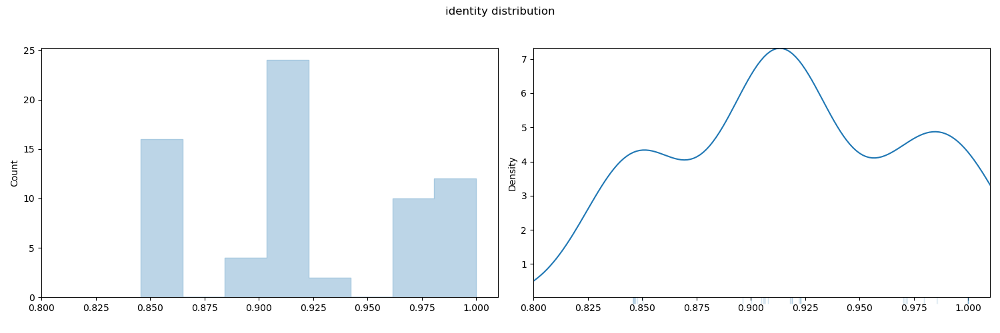
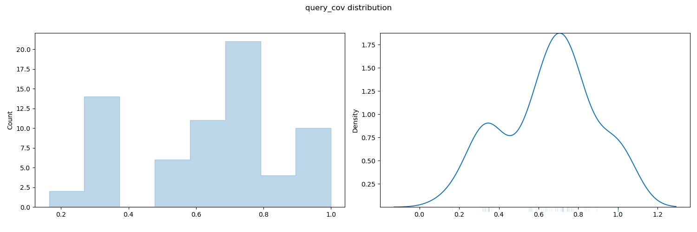
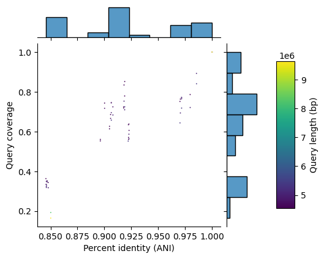
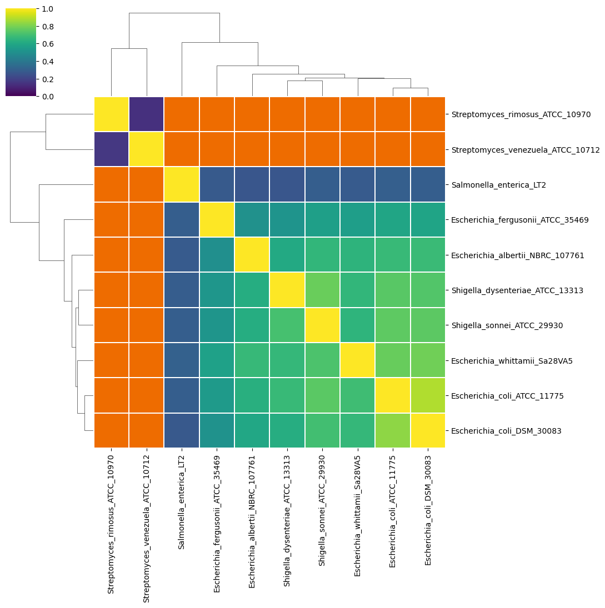
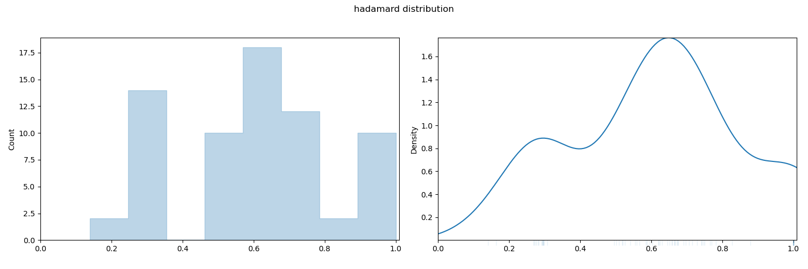
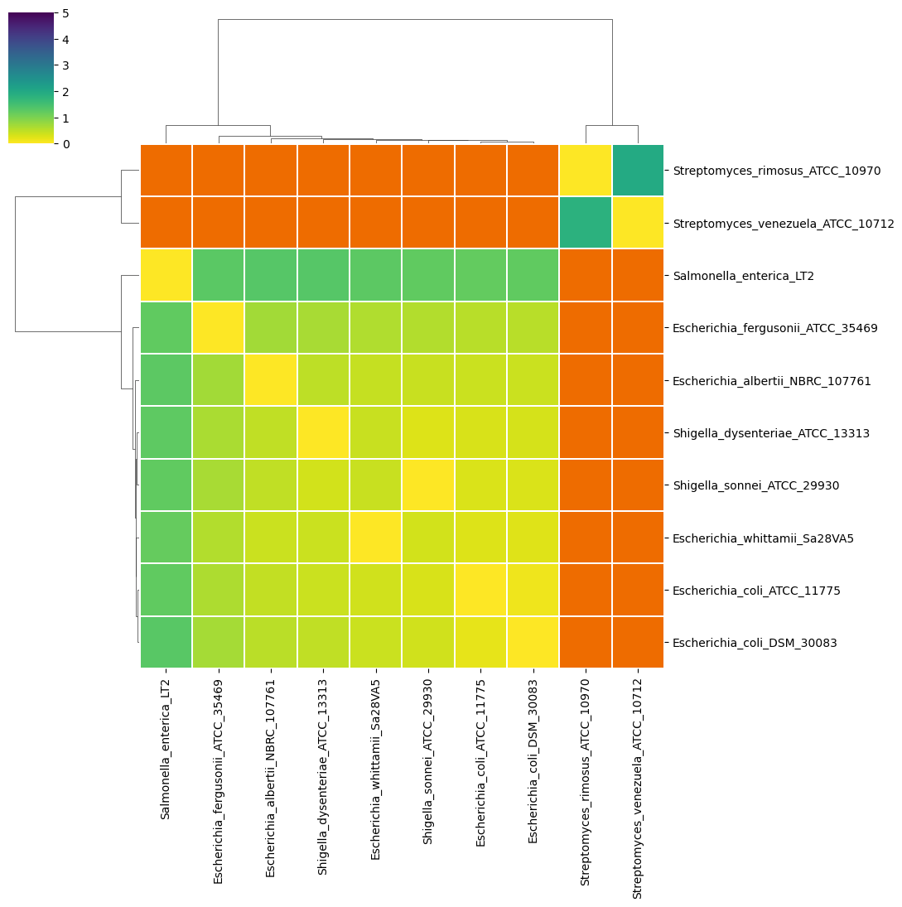
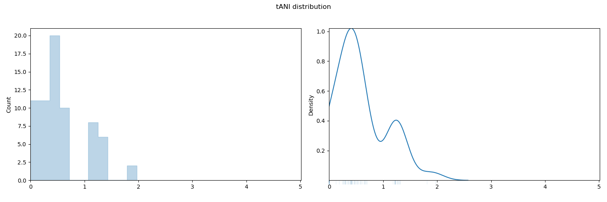
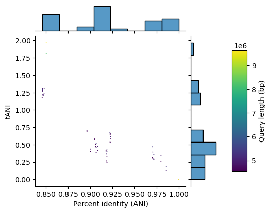
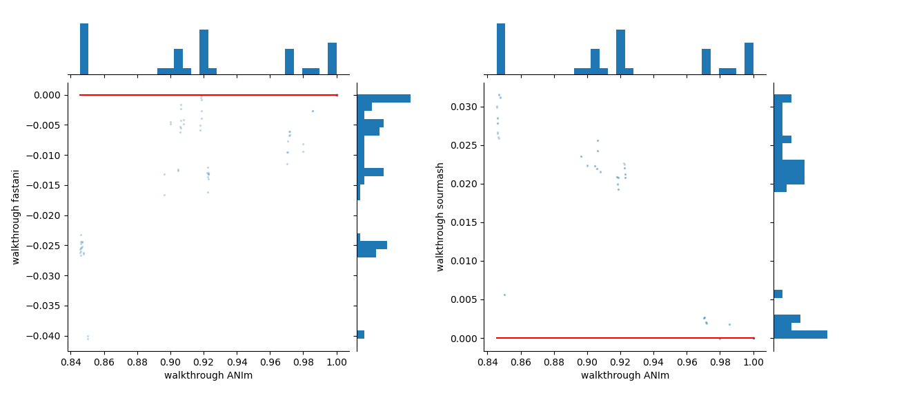

# pyANI-plus walkthrough {.unnumbered}

## Introduction

This section walks through how `pyANI-plus` can be applied to calculate Average Nucleotide Identity, render graphical and tabular summary output, and perform other related measures for whole genome comparisons. The general procedure for any `pyANI-plus` analysis is:

1. Collect genomes for analysis
2. Perform ANI analysis using a chosen method such as ANIb, ANIm, etc.
3. Report as tabular output and/or generate a graphical visualisation
4. Use the analysis results to classify input genomes and generate species hypotheses

::: { .callout-tip}
Before using `pyANI-plus`, make sure to install it on a local machine like a laptop, desktop, server, or cluster. Please see section [installation](installation.qmd#installation) for installation instructions.
:::

Use the command below to generate the help message for `pyani-plus`:

```bash
pyani-plus -h
```

::: { .callout-note }
This is a command-line tool, meaning you type commands into a terminal window to run it. To view avaliable options type `pyani-plus` (in lower case), space, then `-h` (minus lower-case H) for the help option, and finally enter or return to run the command.
:::


This should output the following (or similar) - hopefully in colour depending on your terminal setup:

```bash
 Usage: pyani-plus [OPTIONS] COMMAND [ARGS]...

╭─ Options ─────────────────────────────────────────────────────────────────────────────────────────────╮
│ --version             -v      <bool>  Show tool version (on stdout) and quit.                         │
│ --install-completion          <bool>  Install completion for the current shell.                       │
│ --show-completion             <bool>  Show completion for the current shell, to copy it or customize  │
│                                       the installation.                                               │
│ --help                -h      <bool>  Show this message and exit.                                     │
╰───────────────────────────────────────────────────────────────────────────────────────────────────────╯
╭─ Commands ────────────────────────────────────────────────────────────────────────────────────────────╮
│ resume              Resume any (partial) run already logged in the database.                          │
│ list-runs           List the runs defined in a given pyANI-plus SQLite3 database.                     │
│ delete-run          Delete any single run from the given pyANI-plus SQLite3 database.                 │
│ export-run          Export any single run from the given pyANI-plus SQLite3 database.                 │
│ plot-run            Plot heatmaps and distributions for any single run.                               │
│ plot-run-comp       Plot comparisons between multiple runs.                                           │
│ classify            Classify genomes into clusters based on ANI results.                              │
╰───────────────────────────────────────────────────────────────────────────────────────────────────────╯
╭─ ANI methods ─────────────────────────────────────────────────────────────────────────────────────────╮
│ anim                Execute ANIm calculations, logged to a pyANI-plus SQLite3 database.               │
│ dnadiff             Execute mumer-based dnadiff calculations, logged to a pyANI-plus SQLite3          │
│                     database.                                                                         │
│ animinimap2         Execute ANI minimap2 calculations, logged to a pyANI-plus SQLite3 database.       │
│ anib                Execute ANIb calculations, logged to a pyANI-plus SQLite3 database.               │
│ fastani             Execute fastANI calculations, logged to a pyANI-plus SQLite3 database.            │
│ LZ-ANI              Execute lz-ani ANI calculations, logged to a pyANI-plus SQLite3 database.         │
│ skani               Execute skani ANI calculations, logged to a pyANI-plus SQLite3 database.          │
│ sourmash            Execute sourmash-plugin-branchwater ANI calculations, logged to a pyANI-plus      │
│                     SQLite3 database.                                                                 │
│ external-alignment  Compute pairwise ANI from given multiple-sequence-alignment (MSA) file.           │
╰───────────────────────────────────────────────────────────────────────────────────────────────────────╯
```

To see the options for a specific subcommand, use `pyani-plus <subcommand> -h`. For example, to view options for the ANIm method:

```bash
pyani-plus anim -h
```

Expected output:
 
```bash
  Usage: pyani-plus anim [OPTIONS] {fasta}

 Execute ANIm calculations, logged to a pyANI-plus SQLite3 database.

╭─ Arguments ───────────────────────────────────────────────────────────────────────────────────────────╮
│ *    fasta      <path>  Directory of FASTA files (extensions .fa, .fas, .fasta, .fna). [required]     │
╰───────────────────────────────────────────────────────────────────────────────────────────────────────╯
╭─ Options ─────────────────────────────────────────────────────────────────────────────────────────────╮
│ *  --database   -d      <file>         Path to pyANI-plus SQLite3 database. [required]                │
│    --name               <str>          Run name. Default is 'N genomes using METHOD'.                 │
│    --create-db          <bool>         Create database if does not exist.                             │
│    --executor           <local|slurm>  How should the internal tools be run? [default: local]         │
│    --help       -h      <bool>         Show this message and exit.                                    │
╰───────────────────────────────────────────────────────────────────────────────────────────────────────╯
╭─ Method parameters ───────────────────────────────────────────────────────────────────────────────────╮
│ --mode        <mum|maxmatch>  Nucmer mode for ANIm. [default: mum]                                    │
╰───────────────────────────────────────────────────────────────────────────────────────────────────────╯
╭─ Debugging ───────────────────────────────────────────────────────────────────────────────────────────╮
│ --temp         <dir>   Directory to use for intermediate files, which for debugging purposes will not │
│                        be deleted. For clusters this must be on a shared drive. Default behaviour is  │
│                        to use a system specified temporary directory (specific to the compute-node    │
│                        when using a cluster) and remove this afterwards.                              │
│ --wtemp        <dir>   Directory to use for temporary workflow coordination files, which for          │
│                        debugging purposes will not be deleted. For clusters this must be on a shared  │
│                        drive. Default behaviour is to use a system specified temporary directory (for │
│                        the local executor) or a temporary directory under the present directory (for  │
│                        clusters), and remove this afterwards.                                         │
│ --log          <file>  Where to record log(s). Use '-' for no logging. Default is no logging for the  │
│                        local executor, but otherwise "pyani-plus.log".                                │
│ --debug        <bool>  Show debugging level logging at the terminal (in addition to the log file).    │
╰───────────────────────────────────────────────────────────────────────────────────────────────────────╯
```

## Download walkthrough example genomes

::: { .callout-tip }
While you can work with your choice of genomes as FASTA files placed in a local directory, we suggest using the ten genomes provided in the compressed folder linked below when first following this walkthrough, to ensure the output matches the expected results.

- Walkthrough genome files (compressed): [`walkthrough_data.zip`](./assets/walkthrough_data.zip)
:::

::: { .callout-note }
To uncompress this folder, either use your operating system's built-in tools in the file explorer, or use a command like:

```bash
% unzip -d genomes walkthrough_data.zip
```

The command above should extract the genomes to a new folder called `genomes`:

```bash
% ls genomes
Escherichia_albertii_NBRC_107761.fna.gz   Salmonella_enterica_LT2.fna.gz
Escherichia_coli_ATCC_11775.fna.gz        Shigella_dysenteriae_ATCC_13313.fna.gz
Escherichia_coli_DSM_30083.fna.gz         Shigella_sonnei_ATCC_29930.fna.gz
Escherichia_fergusonii_ATCC_35469.fna.gz  Streptomyces_rimosus_ATCC_10970.fna.gz
Escherichia_whittamii_Sa28VA5.fna.gz      Streptomyces_venezuela_ATCC_10712.fna.gz
```
:::

`pyANI-plus` accepts FASTA files with the extensions `.fasta`, `.fas`, and `.fna`, and gzip compressed formats like `.fasta.gz`, `.fas.gz`, and `.fna.gz`. Please make sure that your input files match these extensions to ensure that `pyANI-plus` works.

## Conducting ANI analysis

`pyANI-plus` enables genome comparison using various ANI methods.

In this walkthrough, we will demonstrate the ANIm, fastANI, and sourmash methods, so we can compare results using the `plot-run-comp` command.

Running any ANI method requires that you specify the directory containing the genome data (e.g., `walkthrough_data/`), and the path to the pyANI-plus SQLite3 database (`walkthrough.db` for this walkthrough).

::: { .callout-warning }
If this is your first analysis and the SQLite3 database does not yet exist, you must use the `--create-db` option when running the comparison otherwise, you will encounter an error similar to:

```bash
ERROR: Database walkthrough.db does not exist, but not using --create-db
```
:::

::: { .callout-tip }
You can provide a custom name for the analysis with the `--name` option for easier reference. If you do not do so, a unique name will be created for the analysis run.
:::

::: { .callout-tip }
If you want to run the ANI analysis on a cluster using SLURM, you must set the execution method using `--executor slurm` (the default is `--executor local`).
:::

### ANIm analysis

We first run ANIm analysis on the downloaded genomes, creating the local database, using the command line:

```bash
pyani-plus anim genomes --database walkthrough.db --create-db --name "walkthrough ANIm"
```

With the walkthrough dataset this should take about 2-5 minutes on a modern multi-core desktop or laptop computer. When complete, the run should report the run ID and the path to the results database:

```bash
[...]
Comparing pairs ━━━━━━━━━━━━━━━━━━━━━━━━━━━━━━━━━━━━╺━━━  91% 0:02:07  91/100
INFO     Completed ANIm run-id 1 with 10 genomes in database walkthrough.db
```

::: { .callout-note }
In ANIm analysis, the default setting uses anchor matches that are unique in the reference but not necessarily unique in the query (`--mode mum`). You can change this to include all anchor matches, regardless of their uniqueness, by setting the `--mode` option to `maxmatch`.

Similar method-specific options can be set with other ANI subcommands.
:::

You can confirm that the run is present in the database using the `pyani-plus list-runs` command:

```bash
% pyani-plus list-runs -d walkthrough.db

                           1 analysis runs in walkthrough.db
┏━━━━┳━━━━━━━━━━━━┳━━━━━━━━┳━━━━━━┳━━━━━━┳━━━━━━┳━━━━━━━━━┳━━━━━━━━┳━━━━━━━━━━━━━━━━━━┓
┃ ID ┃ Date       ┃ Method ┃ Done ┃ Null ┃ Miss ┃ Total   ┃ Status ┃ Name             ┃
┡━━━━╇━━━━━━━━━━━━╇━━━━━━━━╇━━━━━━╇━━━━━━╇━━━━━━╇━━━━━━━━━╇━━━━━━━━╇━━━━━━━━━━━━━━━━━━┩
│  1 │ 2026-11-11 │ ANIm   │   68 │   32 │    0 │ 100=10² │ Done   │ walkthrough ANIm │
└────┴────────────┴────────┴──────┴──────┴──────┴─────────┴────────┴──────────────────┘
```

::: { .callout-important }
In the example above there are 32 `null` comparisons. These are pairwise genome comparisons where the method has been unable to produce a result. Usually, this is because the genomes do not have sufficient sequence similarity to produce a meaningful comparison.
:::

### Conduct `fastani` analysis

To run `fastani` analysis on the genomes in the input `genomes` directory use the following command line:

```bash
pyani-plus fastani genomes --database walkthrough.db --name "walkthrough fastani"
```

With the walkthrough dataset this should take less than 30 seconds on a modern multi-core desktop or laptop computer.

::: { .callout-tip }
In `fastani` analysis, additional method parameters can be changed by the user. These include:

- `--fragsize`: Fragment length used in the analysis (default: `3000`).
- `--kmersize`: _k_-mer size, set to `16` by default. It can be set to any value smaller than 16.
- `--minmatch`: Minimum fraction of the genome that must be shared for ANI to be considered reliable. If the reference and query genome sizes differ, the smaller genome is used. (Default: `0.2`).
:::

The updated database can be viewed using the `pyani-plus list-runs` command:

```bash
% pyani-plus list-runs -d walkthrough.db

                             2 analysis runs in walkthrough.db
┏━━━━┳━━━━━━━━━━━━┳━━━━━━━━━┳━━━━━━┳━━━━━━┳━━━━━━┳━━━━━━━━━┳━━━━━━━━┳━━━━━━━━━━━━━━━━━━━━━┓
┃ ID ┃ Date       ┃ Method  ┃ Done ┃ Null ┃ Miss ┃ Total   ┃ Status ┃ Name                ┃
┡━━━━╇━━━━━━━━━━━━╇━━━━━━━━━╇━━━━━━╇━━━━━━╇━━━━━━╇━━━━━━━━━╇━━━━━━━━╇━━━━━━━━━━━━━━━━━━━━━┩
│  1 │ 2026-11-11 │ ANIm    │   68 │   32 │    0 │ 100=10² │ Done   │ walkthrough ANIm    │
│  2 │ 2026-11-11 │ fastANI │   68 │   32 │    0 │ 100=10² │ Done   │ walkthrough fastani │
└────┴────────────┴─────────┴──────┴──────┴──────┴─────────┴────────┴─────────────────────┘
```

### `sourmash` analysis

Lastly, we can run `sourmash` analysis with the following command line:

```bash
pyani-plus sourmash genomes --database walkthrough.db --name "walkthrough sourmash"
```

With the walkthrough dataset this should take less than 15 seconds on a modern multi-core desktop or laptop computer.

::: { .callout-tup }
For `sourmash` analysis, additional method parameters can be changed by the user. These include:

- `--scaled`: Compression ration (defult: `1000`)
- `--kmersize`: _k_-mer size (default: `31`)
:::

## Reporting Analyses and Results

### List all runs in the database {#list-runs}

`pyANI-plus` enables you to view all runs defined in a SQLite3 database. To display all runs from the database (eg. `walkthrough.db` for this walkthrough), use the command:

```bash
pyani-plus list-runs --database walkthrough.db
```

You should see the following table, or something similar, depending on the analyses contained within the database:

```
                              3 analysis runs in walkthrough.db
┏━━━━┳━━━━━━━━━━━━┳━━━━━━━━━━┳━━━━━━┳━━━━━━┳━━━━━━┳━━━━━━━━━┳━━━━━━━━┳━━━━━━━━━━━━━━━━━━━━━━┓
┃ ID ┃ Date       ┃ Method   ┃ Done ┃ Null ┃ Miss ┃ Total   ┃ Status ┃ Name                 ┃
┡━━━━╇━━━━━━━━━━━━╇━━━━━━━━━━╇━━━━━━╇━━━━━━╇━━━━━━╇━━━━━━━━━╇━━━━━━━━╇━━━━━━━━━━━━━━━━━━━━━━┩
│  1 │ 2026-11-11 │ ANIm     │   68 │   32 │    0 │ 100=10² │ Done   │ walkthrough ANIm     │
│  2 │ 2026-11-11 │ fastANI  │   68 │   32 │    0 │ 100=10² │ Done   │ walkthrough fastani  │
│  3 │ 2026-11-11 │ sourmash │   68 │   32 │    0 │ 100=10² │ Done   │ walkthrough sourmash │
└────┴────────────┴──────────┴──────┴──────┴──────┴─────────┴────────┴──────────────────────┘
```

In this table, each row represents a single run, and the columns provide the following information:

- `ID`: Unique ID for the run
- `Date`: Date when the analysis was executed
- `Method`: ANI method used
- `Done`: Number of completed ANI comparisons
- `Null`: Number of analyses where no alignment was found (e.g., comparisons between highly divergent genomes)
- `Miss`: Number of comparisons that were not completed for another reason
- `Status`: Current status of the analysis, e.g. `Done` for completed analyses, and `Running` for comparisons that have started but are still in progress
- `Name`: Run name.

### Exporting ANI results in tabular format

`pyANI-plus` allows ANI results to be exported in a tabular format. We use the following command to export results for the ANIm analysis to a new directory called `walkthrough_output`:

```bash
pyani-plus export-run --database walkthrough.db --outdir walkthrough_output --run-id 1
```

::: { .callout-tip}
If `--run-id` is not specified the most recent run from the database will be exported.

To export runs for other analyses, you can specify the `--run-id` by matching the ID number provided in the table provided by [list-runs subcommand](walkthrough.qmd#list-runs).
:::

This writes output to new files in the `walkthrough_output` directory. Matrix output files are named `<method>_<property>.tsv` while the long (`tidy`) format output suitable for analysis in `R` is named `<method>_run_<run-id>.tsv`. 

```
% tree walkthrough_output
walkthrough_output
├── ANIm_aln_lengths.tsv
├── ANIm_hadamard.tsv
├── ANIm_identity.tsv
├── ANIm_query_cov.tsv
├── ANIm_run_1.tsv
├── ANIm_sim_errors.tsv
└── ANIm_tANI.tsv
```

::: { .callout-note }
The long (`tidy`) format file presents one row per genome comparison, with columns as below.

```text
#Query	Subject	Identity	Query-Cov	Subject-Cov	Hadamard	tANI	Align-Len	Sim-Errors
GCF_002950395.1_ASM295039v1_genomic	GCF_014836715.1_ASM1483671v1_genomic	0.9154744964243148	0.672804430756021	NA	0.6159352974384161	0.4846133575912978	3359986	284072
```
:::

::: { .callout-important}
- Incomplete runs will return an error.
- There will be no output for an empty run. 
- For partial runs only the long form table of completed comparisons will be exported, not the matrices.
:::

### Graphical output

Graphical output (`JPG`, `PDF`, `PNG` and `SVGZ` formats) can be generated for a single run by executing the `pyani-plus plot-run` subcommand, specifying the database and ouput directory:

```bash
% pyani-plus plot-run --database walkthrough.db --outdir walkthrough_output/ --run-id 2
```

::: { .callout-tip}
If `--run-id` is not specified the most recent run will be used to generate graphical output.

To generate graphical output for other analyses, you can specify the `--run-id` by matching the ID number provided in the table provided by [list-runs subcommand](walkthrough.qmd#list-runs).

Optionally, genomes can be labelled using either `md5` or `filename` using the `--label` option. 
:::

`plot-run` subcommand generates heatmaps, distribution plots, and tabular output from an ANI analysis for the specified `--run_id`.

#### percentage identity of aligned regions (ANI) 

- pairwise identity heatmap: `<method>_identity_heatmap.<extension>` (@fig-anim-heatmap)
- distribution plots: `<method>_identity_dist.<extension>` (@fig-anim-dist)
- pairwise identity matrix: `<method>_identity.tsv` 

![ANIm percentage identity heatmap for the walkthrough data. Each cell represents a pairwise comparision between the genomes shown in the rows and columns, showing the pairwise identity of aligned regions as on the scale at top left. Dendrograms are single-linkage clustering trees generated from the matrix of pairwise identity results. The default color scheme assigns red to cells with identity $\geq 0.95$, blue to those with identity $<0.95$, and orange to cells representing comparisons with no alignment found (e.g., NULLs). This division corresponds to a widely-used convention for bacterial species boundaries.](walkthrough_plots/ANIm_identity_heatmap.png){#fig-anim-heatmap .lightbox width=80%}

{#fig-anim-dist .lightbox width=80%}

#### percentage coverage of each query genome by aligned regions

- heatmap: `<method>_query_cov_heatmap.<extension>` @fig-anim-cov-heat
- distribution plots: `<method>_query_cov_dist.<extension>` @fig-anim-cov-dist
- scatterplot of coverage vs ANI: `<method>_query_cov_scatter.<extension>` @fig-anim-cov-scatter
- data matrix: `<method>_query_cov.tsv`)

![ANIm percentage coverage heatmap for walkthrough data. Each cell represents a pairwise comparision between the genomes shown in the rows and columns. Pairwise coverage of each genome by aligned regions in the comparison is coloured as in the scale at top left. Dendrograms are single-linkage clustering trees generated from the matrix of pairwise coverage results. The default color scheme assigns red to cells with coverage $\geq 0.50$, blue to those with coverage $<0.50$, and orange to cells representing comparisons with no alignment found (e.g., NULLs). This division corresponds to a strict majority of each genome in the comparison being alignable (a plausible minimum requirement for two sequences being considered “the same thing”).](walkthrough_plots/ANIm_query_cov_heatmap.png){#fig-anim-cov-heat .lightbox width=80%}

{#fig-anim-cov-heat .lightbox width=80%}

{#fig-anim-cov-heat .lightbox width=80%}


#### Hadamard matrix (percentage identity multiplied by percentage coverage) for each comparison

- heatmap: `<method>_hadamard_heatmap.<extension>` @fig-anim-hadamard-heat
- distribution: `<method>_hadamard_dist.<extension>` @fig-anim-hadamard-dist
- data matrix: `<method>_hadamard.tsv`

{#fig-anim-hadamard-heat .lightbox width=80%}

{#fig-anim-hadamard-dist .lightbox width=80%}


#### Total Average Nucleotide Identity (tANI) matrix of the negative log of the coverage multiplied by identity

- heatmap: `<method>_tANI_heatmap.<extension>` @fig-anim-tani-heat
- distribution: `<method>_tANI_dist.<extension>` @fig-anim-tani-dist
- scatterplot: `<method>_tANI_scatter.<extension>` @fig-anim-tani-scatter
- data matrix: `<method>_tANI.tsv`

{#fig-anim-tani-heat .lightbox width=80%}

{#fig-anim-tani-dist .lightbox width=80%}

{#fig-anim-tani-scatter .lightbox width=80%}

#### Additional data matrices

- number of “similarity errors” on each genome: `<method>_sim_errors.tsv`
- long (`tidy`) form of ANI results which include the query and subject genomes and all the comparison properties as columns: `<method>_run_<ID>.tsv`

## Plotting comparisons between runs

ANI results vary for the same pairwise comparison, depending on the method used. `pyANI-plus` allows you to compare ANI results across multiple methods. In example below we use the `pyani-plus plot-run-comp` subcommand to visualise and compare more than one analysis.

::: { .callout-important}
The first run ID provided will be treated as the reference, against which all subsequent runs are compared.
:::

```bash
pyani-plus plot-run-comp --database walkthrough.db --outdir walkthrough_output/ --run-ids 1,2,3
```

This command generates the following scatterplots where _x_-axis represents reference method results, and the _y_-axis represents results reported by other methods:

- ANI scatterplots: `<reference_method>_identity_<run_ID>_scatter_vs_others.<extension>` (@fig-comparison-ani-scatter)
- scatterplots of ANI deviation from the reference method: `<reference_method>_identity_<run_ID>_scatter_vs_others.<extension>` (@fig-deviation-ani-scatter)

{#fig-comparison-ani-scatter .lightbox width=80%}

{#fig-deviation-ani-scatter .lightbox width=80%}

The command also generates tabular summaries of individual method comparisons within files with the filename format `<reference_method>_identity_<run_ID>_vs_<run_ID>.tsv`.

